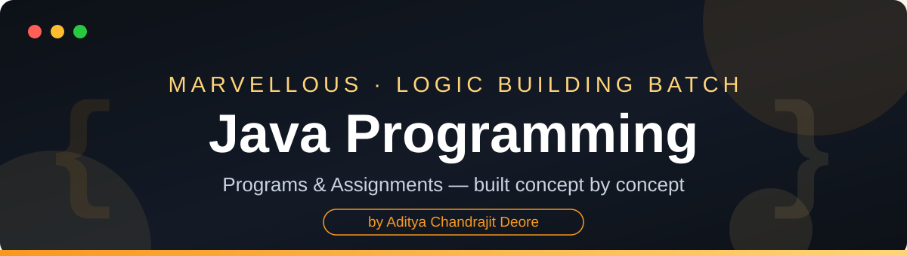

<div align="center">



<br/>


</div>

---

## 📖 About

This repository holds my **Java programming** work for the **Marvellous Logic Building Batch** — covering the Java way of solving the same logic problems: classes and objects, constructors, `this` and `static`, inheritance, interfaces, packages, exception handling, and collections.

Programs are added here assignment by assignment, in batch order, as the Java stage progresses — each one compiled and tested before it is committed.

---

## 🗂️ Structure

```text
Java_Programming/
│
├── README.md
├── LICENSE
├── .gitignore
├── assets/                 ← banner & footer artwork used in this README
│
├── Assignments/
│   ├── Assignment_1/       ← program1_1.java … program1_5.java
│   ├── Assignment_2/
│   └── …
│
└── Classwork/
    └── Day_NN/             ← classwork, added as the batch progresses
```

- **5 programs per assignment**, one folder per assignment: `Assignments/Assignment_N/`
- File naming follows the batch convention: `programN_M.java`, with package folders where the program needs them

---

## ▶️ How to Compile & Run

```bash
javac program1_1.java
java program1_1
```

---

## 👨‍💻 Author

<div align="center">

**Aditya Chandrajit Deore**
B.Tech Information Technology — PCCOE, Pune

[](https://github.com/AdityaxDeore)
[](https://www.linkedin.com/in/aditya-deore-3a725a263/)
[](https://adityadeore.vercel.app)
[](https://x.com/AdityaDeore2678)


</div>
